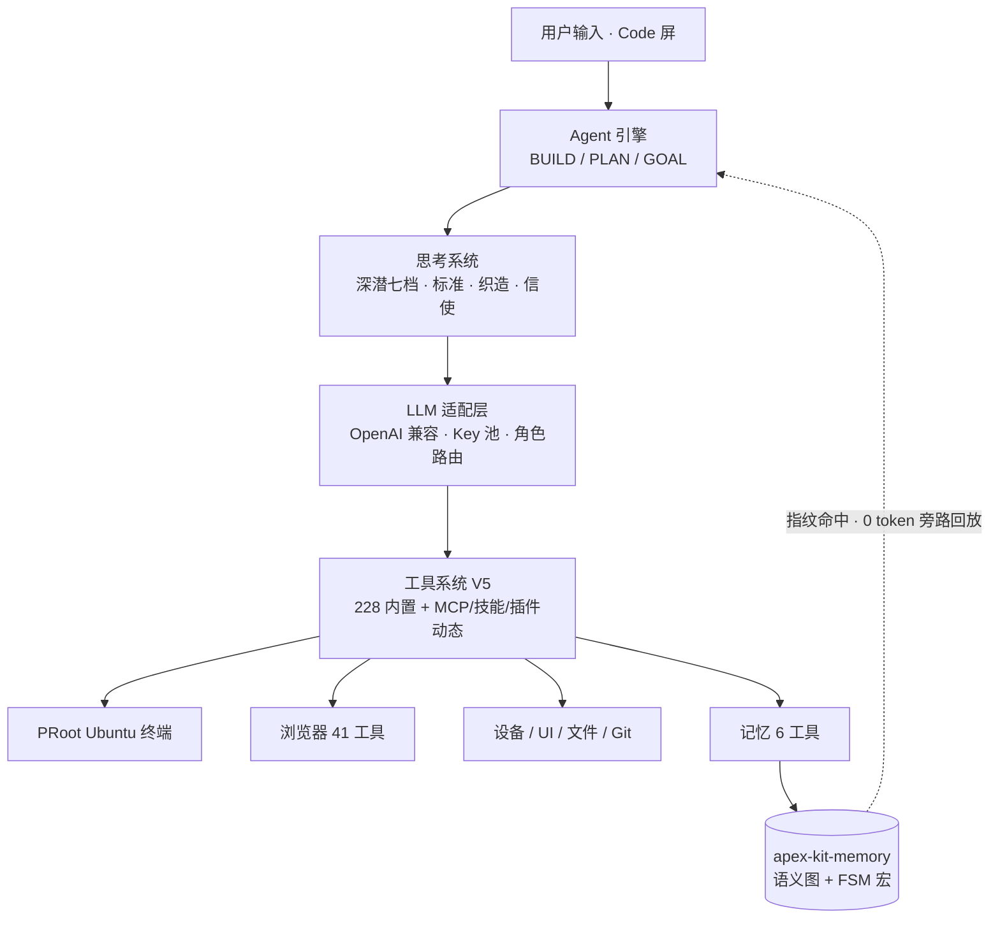

<a id="readme-top"></a>

<!-- ═══════════════════════════ HERO ═══════════════════════════ -->

<div align="center">



<a href="#quickstart"></a>

# Android Guru Agent

**看代码 · 写代码 · 跑终端 · 开浏览器 · 记经验 —— 一部 Android 手机全部做完。**

一个开源的 Android 端 AI 编码工作台：OpenAI 兼容流式 LLM 接入、四条思考逻辑线
（深潜七档 / 标准 / 织造 / 信使，运行时可切）、**228 个静态注册工具**（八层执行
硬化 + v4 渐进披露）、PRoot 沙箱化 **Ubuntu 24.04** 终端（真 `apt`、C++ PTY）、
**41 个浏览器自动化工具**、apex-kit-memory 认知记忆（差分摄取 → 轨迹蒸馏 →
FSM 旁路回放 → 梦境巩固）、Root → Shizuku → Shell 三级权限执行链、
MCP × 技能 × 市场 × 插件四层扩展 —— 全部跑在一台手机上，无需服务器，无需 PC。

> [!NOTE]
> **找不到原来的纯聊天页面？** 它已从本应用移除。本仓库专注 Coding，
> Agent 聊天模式转至独立项目 [Theocracy](https://github.com/Ultra-Guru/Theocracy)；
> 其安装包发布情况以该项目 [Releases](https://github.com/Ultra-Guru/Theocracy/releases)
> 实际列表为准，不要仅为找回入口就覆盖安装旧版（聊天数据迁移兼容性尚未验证）。

**徽章**

<a href="https://github.com/Ultra-Guru/Android-Guru-Agent/actions/workflows/ci.yml"></a>
<a href="https://github.com/Ultra-Guru/Android-Guru-Agent/actions/workflows/quality-gate.yml"></a>
<a href="https://github.com/Ultra-Guru/Android-Guru-Agent-Release/releases/latest"></a>


<a href="#tools"></a>
<a href="#testing"></a>
<a href="#architecture"></a>
<a href="#license"></a>

**快速跳转**

<a href="#quickstart"></a>
<a href="#fit-matrix"></a>
<a href="#tools"></a>
<a href="#architecture"></a>
<a href="#docs-index"></a>
<a href="#faq"></a>
<a href="https://github.com/Ultra-Guru/Android-Guru-Agent/releases"></a>

</div>

---

## 📖 目录

<table>
<tr>
<td valign="top" width="50%">

**能力**
- [📦 立即获取](#download)
- [🧩 我能不能用（能力矩阵）](#fit-matrix)
- [✨ 核心能力总览](#highlights)
- [🔄 Agent 引擎与三种模式](#engine)
- [💭 思考系统（四条逻辑线）](#thinking)
- [🖥️ 终端运行时（Ubuntu + PRoot）](#terminal-runtime)
- [🌐 浏览器智能体（41 工具）](#browser)
- [🧠 认知记忆（apex-kit-memory）](#memory)

</td>
<td valign="top" width="50%">

**工程**
- [⚡ 权限执行链](#privilege) · [🧩 扩展生态](#ecosystem)
- [🏗️ 架构总览](#architecture) · [🔧 工具全景（228）](#tools)
- [🚀 快速开始](#quickstart) · [🆚 横向对比](#comparison)
- [🧪 测试与质量](#testing) · [📊 CI/CD（18 流水线）](#cicd)
- [📁 仓库结构与规模](#structure) · [🗺️ 路线图](#roadmap)
- [🎮 周边与彩蛋](#playground) · [📄 文档索引](#docs-index)
- [❓ FAQ](#faq) · [🧭 术语速查](#glossary) · [🤝 贡献](#contributing) · [⚖️ 许可证](#license)

</td>
</tr>
</table>

---

<a id="download"></a>
## 📦 立即获取

| 渠道 | 说明 |
|------|------|
| 📦 **[发布仓库 Releases](https://github.com/Ultra-Guru/Android-Guru-Agent-Release/releases/latest)** | 正式版 APK（arm64 / universal）。双仓库架构：**PR 合并进 main 即自动构建发布**，无需打 tag |
| 🔄 应用内更新 | 「设置 → 关于 → 检查更新」—— VCDIFF 增量补丁（约 14MB vs 全量 300MB+），下载后应用内自动合成并拉起安装，跨版本按 [patches.json](https://github.com/Ultra-Guru/Android-Guru-Agent-Release/blob/main/patches.json) 链式升级 |
| 🧪 [CI debug 工件](https://github.com/Ultra-Guru/Android-Guru-Agent/actions/workflows/ci.yml) | `app-debug-apk`（debug 构建，保留 14 天） |
| 💬 聊天版？ | 纯聊天模式在 [Theocracy](https://github.com/Ultra-Guru/Theocracy/releases) —— 两个项目下载入口不要混淆 |

> 版本口径：源码基线 `1.5`（versionCode 179），发布线已滚动至 **v1.5.24**；
> 以发布仓库 Releases 实际列表为准。

<p align="right"><a href="#readme-top" title="返回顶部">⬆️ 返回顶部</a></p>

---

<a id="fit-matrix"></a>
## 🧩 我能不能用？（可组合能力矩阵）

**每列独立成立，任选组合** —— 三列都满足，就是完整的口袋智能体：

| 🧠 大脑 Brain | 🦾 肌肉 Muscles | 🧵 记忆 Memory |
|--------------|----------------|---------------|
| 任一 **OpenAI 兼容端点**：OpenAI（含 o1/o3/o4-mini/gpt-5 严格推理模型）/ DeepSeek / Qwen(DashScope) / OpenRouter / Gemini OpenAI 兼容层 / Anthropic 兼容层 / vLLM / OneAPI / 局域网 Ollama | **PRoot Ubuntu 24.04** 沙箱终端（免 Root）<br/>41 个 `browser_*` 网页自动化工具<br/>a11y UI 语义交互 + 三级权限 shell | **apex-kit-memory**：语义图 + FSM 宏<br/>命中即 **0 token** 旁路回放<br/>App 升级后拓扑别名桥保鲜 |
| 加分项：Key 池轮换 · 多模型角色路由 · `reasoning_content` 思维链透传 | 加分项：Root 设备解锁 chroot 后端 | 加分项：充电空闲时梦境巩固 |

**设备适配阶梯**（从零配置到全解锁）：

| 你的设备 | 解锁的能力 |
|----------|-----------|
| 普通 Android 8.0+（API 26） | ✅ 全功能基线：PRoot Ubuntu 沙箱终端 + 应用沙箱 shell + 228 工具 + 浏览器 + 记忆 |
| + [Shizuku](https://shizuku.rikka.app/) | ➕ ADB 级权限（uid=2000）：pm install / settings / input / dumpsys |
| + Root | ➕ chroot Ubuntu 后端（T98）+ `su` 特权链全系统操作 |
| + 无障碍授权 | ➕ UI 语义交互（UiTap/UiDump）+ 屏幕感知（记忆采集）+ a11y 截图 |
| ABI 覆盖 | arm64-v8a · armeabi-v7a · x86_64（PRoot 三 ABI 内置，sha256 锁定） |

> targetSdk 有意钉死 **28**（与 Termux 同款：保住 SELinux `untrusted_app` 的
> W^X 执行红线，PRoot 用户态翻译必须的 `exec()` 才能活）。compileSdk 36。

<p align="right"><a href="#readme-top" title="返回顶部">⬆️ 返回顶部</a></p>

---

<a id="highlights"></a>
## ✨ 核心能力总览

| | 能力 | 说明 |
|:---:|------|------|
| 🖥️ | **真 Linux 终端** | 设备上供给 Ubuntu 24.04 官方 rootfs（24.04.4 / noble，sha256 锁定），PRoot 用户态沙箱 + 原生 C++ PTY（forkpty/JNI）+ 自研 VT100/ANSI 模拟器（C++17 热路径零堆分配），`apt install`、bash 脚本皆可 |
| 🌐 | **内置浏览器智能体** | 41 个 `browser_*` 工具：DOM 级操控 + 语义哈希稳定 ref（SPA 刷新不失效）+ 批量动作 + v2.1.0 异步导航协议（BrowserTask 编排）+ executeJs 逃生舱 + 悬浮球 / 浮窗浏览器 |
| 🧠 | **仿生认知记忆** | 差分摄取（SceneDiffer，压缩 95%+）→ ReAct 轨迹蒸馏（MacroDistiller）→ FSM 宏 **0 token 旁路回放** → 梦境巩固（充电+空闲维护窗）；能量遗忘与晶化、记忆免疫隔离、跨版本拓扑迁移 |
| 💭 | **四条思考逻辑线** | 深潜（七档 NONE→ULTRACODE→APEXCODE + AUTO 预检）/ 标准（五画像·权限三态门·task 子代理）/ 织造（apex-kit-loom 经纬交织）/ 信使（apex-kit-courier 驿传并行），运行时可切 |
| 🛰️ | **BYO-LLM** | OpenAI 兼容协议 + 多模型角色路由（含图片自动走 VISION）+ Key 池四轮换模式 + `reasoning_content` 原生思维链透传（R1 / Qwen3-thinking / o 系列） |
| 🖐️ | **工具系统 V5** | **228 个静态注册工具**（v4 渐进披露：70 个 CORE 常驻，按需展开）+ 八层执行硬化（超时/重试/限流/熔断/追踪/批量/组合动作/环境门控）+ MCP/技能/插件动态扩展 |
| 🗜️ | **上下文工程** | 三级压缩：工具输出智能截断 → 滑动窗口 → LLM 摘要；双引擎统一水位检查，长任务不爆窗口 |
| ⚡ | **三级权限执行链** | Root → Shizuku → 普通沙箱 shell 自动降级（30s 缓存 + 审计日志），无 Root 设备也能执行 ADB 级命令；无障碍服务作为独立 UI 能力层 |
| 🧩 | **四层扩展生态** | MCP（7 台内置服务器 + stdio/http 双传输 + `run_in_sandbox` 路由进 PRoot）× 技能（热重载装卸）× 市场（8 个源）× 插件（声明式功能性 + APK AIDL 双形态） |
| ⚛️ | **FusionBundle 聚变包** | 「技能+MCP+工具+工作流」一键聚合激活：内置 REA / Superpowers / SuperClaude / BMAD / Anthropic Skills / Claude Flow SPARC / Shrimp 七大体系 |
| 🕓 | **长任务中心** | 超阈值运行自动留档；检查点时间线回看 + 续跑不从头 + 复制带上下文重跑 + 同目标运行对比 |
| 🪞 | **Liquid Glass 玻璃系统** | vendored kyant backdrop 引擎（Apache-2.0）：七档材质玻璃组件，彩色高光 + 深浅色适配 |

> [!IMPORTANT]
> **这一切跑在一台普通 Android 手机上。** 不需要服务器，不需要 PC 伴侣，
> 配置任意 OpenAI 兼容 API（或局域网 Ollama）即获得完整的智能体闭环。

<p align="right"><a href="#readme-top" title="返回顶部">⬆️ 返回顶部</a></p>

---

<a id="engine"></a>
## 🔄 Agent 引擎与三种模式

`core:agent-engine` 的编排内核：任务状态机（`TaskStatusMachine`）+ Plan 图
（`PlanGraph` 人工确认闸）+ 失败分类与恢复规划（`FailureClassifier` /
`RecoveryPlanner`）+ 用户交互门（AskUser 桥，可中止）+ 压缩门与钩子协调。

**三种工作模式**（`AgentMode`，v1.5 随聊天模式剥离后的纯 Coding 面）：

| 模式 | 行为 | 适合 |
|------|------|------|
| 🔨 **BUILD** | 边想边做，实时执行工具 | 日常编码、小改动、探索式任务 |
| 📋 **PLAN** | 先产出完整计划，**人工确认后**才开始执行 | 高风险操作、跨文件重构 |
| 🎯 **GOAL** | 目标驱动：设定可验证条件，持续工作直至达成（`GoalVerifier` 校验） | 长任务、迭代收敛型目标 |

> 历史注记：旧版 CHAT/AGENT/LOOP 档位与 v1/v2 的 SPEC / REFLECTION /
> HUMAN_ASSIST / CUSTOM 模式已随 Agent 聊天剥离移除，旧持久化值自动回退 BUILD。

**编排器状态机（真实转移）**：

```text
CREATED ──▶ PLANNING ──▶ AWAITING_CONFIRM ──▶ RUNNING ──▶ COMPLETED
                │              │ (拒绝)            │
                │              ▼                   ├─▶ PAUSED ──▶ RUNNING
                │          CANCELLED               ├─▶ ASKING_USER ──▶ RUNNING
                └──────────────┴───────────────────┴─▶ FAILED ──▶ (恢复规划) ──▶ RUNNING
```

<p align="right"><a href="#readme-top" title="返回顶部">⬆️ 返回顶部</a></p>

---

<a id="thinking"></a>
## 💭 思考系统：四条逻辑线

Coding 屏右上角随时切换（`/logic` 斜杠命令同效）：

| 逻辑线 | 引擎 | 范式 |
|--------|------|------|
| 🤿 **深潜** | `code-engine`（CodeThinkingLevel） | **七档深度 + AUTO**：NONE / LIGHT / STANDARD / DEEP / MAXIMUM / ULTRACODE / APEXCODE；档位驱动提示词、模型参数、迭代倍率、压缩阈值、输出预算**全执行画像**；AUTO 发送前预检选档、深水区自动升级 |
| ⚙️ **标准** | 标准任务循环 | 五画像 · 权限三态门 · task 子代理 · 上下文压缩 · C++ 文本核加速 |
| 🧶 **织造** | [apex-kit-loom](docs/loom-engine.md) | 经纬交织范式：in-band XML 工具协议 · 梭回合机 · 子线程群 · digest 织入压缩 |
| 📮 **信使** | [apex-kit-courier](docs/courier-engine.md) | 驿传调度范式：收发匣投递 · 趟次步进机并行纤程 · 勘通配则例 · 档房卷宗压缩 · 下站子驿委派 |

自适应思考选择（`AdaptiveThinkingSelector` + `ThinkingSignalAnalyzer`）：
按任务信号（复杂度 / 失败历史 / token 预算）在档位间升降，
避免简单任务烧深度、复杂任务欠思考。

<p align="right"><a href="#readme-top" title="返回顶部">⬆️ 返回顶部</a></p>

---

<a id="terminal-runtime"></a>
## 🖥️ 终端运行时（Ubuntu + PRoot）

`platform:terminal` 在设备上供给并运行一个**真实的 Ubuntu 24.04 用户态 Linux**：

| 层 | 实现 | 要点 |
|----|------|------|
| rootfs 供给 | `BundledRootfsSource` + `UbuntuBootstrapManager` | 官方 Ubuntu 24.04.4 归档（sha256 锁定，tag `ubuntu-rootfs-24.04.4-full`）+ 58 基础包；断点续装、自举状态机 |
| 执行后端 | `LinuxPRootBackend` / `LinuxChrootBackend` | PRoot 用户态沙箱（**无需 Root**）；rooted 设备可切 T98 真 chroot 后端；PRoot so 随 APK jniLibs 分发（三 ABI，指纹校验防篡改） |
| PTY | C++ `forkpty`（`pty_engine.cpp` / `jni_bridge.cpp`） | 原生伪终端、argv 编组、进程组信号、会话隔离 |
| 终端模拟 | `terminal-emulator` + `terminal-native` | 自研 VT100/ANSI：转义解析、滚动区、24 位色、UTF-8 边界；热路径 C++17 引擎（apex-native-vt，每字符零堆分配），Kotlin 实现保留为语义基准与 JVM 回退 |
| 观察引擎 | `ObservationEngine2` + `SemanticStateReducer` | 把 ANSI 噪音降维成语义状态（等待输入/运行中/完成/错误），提示符识别 |
| 包管理 | `UbuntuAptPackageManager` + `PackageOperationLock` | 设备上 `apt install`（含 Ubuntu 批量状态解析），并发锁防交错 |
| 环境自适应 | `AdaptiveProvisionLoop` + `DiagnosticRules` | 执行观察 → 诊断规则 → 自动修复（ResolverCache） |
| 会话持久化 | `SessionMetadataStore` + 关机恢复 | 重启恢复会话元数据 |
| 本地搜索 | `SearxngLifecycleCoordinator` | SearxNG 本地实例安装与生命周期 —— [本地优先搜索链](docs/searxng-local-search.md) |

**terminal.\* 工具族**暴露给 LLM：会话创建 / 结构化 exec / 观察与快照 / 信号 /
PTY 写入 / 工作区 / 后端清单 / Ubuntu 一键生命周期编排 / 包管理 / 诊断与自修复。

> [!TIP]
> 测试含**真实 E2E**：CI 下载真 Ubuntu rootfs + Debian proot 5.4 跑真实 guest
> 进程（bash / apt）；proot 不可用时诚实自跳过高级别场景。

<p align="right"><a href="#readme-top" title="返回顶部">⬆️ 返回顶部</a></p>

---

<a id="browser"></a>
## 🌐 浏览器智能体（41 工具）

对标 Operit BrowserAgent / Playwright MCP：DOM 级网页操控，而非截图盲点。

| 工具族 | 数量 | 内容 |
|--------|------|------|
| 🕸️ **Agent** | 26 | `navigate` `click` `input` `select` `toggle` `scroll` `screenshot`(含全页拼接) `snapshot`(focused/diff 模式) `show` `file_upload` `date_input` `context_summary` `network_log` `download_list` `wait_for` `page_type` `press_key` `hover` `drag` `extract_content` `execute_js` `get_cookies` `locate` `tabs` + **`batch_actions`**（一次串行 ≤8 动作） |
| 🧭 **Session** | 9 | `back` `forward` `reload` `history` `find` `downloads` `bookmarks` `zoom` `clear_data` |
| 📐 **Layout** | 1 | `analyze_layout` —— 真实渲染几何分析 |
| ⚡ **Async（v2.1.0）** | 5 | `BrowserTask`（异步任务编排）`navigate_async` `doc_state` `doc_events` `doc_control` |

**工程细节**：

- **语义哈希稳定 ref**：元素引用基于语义哈希而非 DOM 序号，SPA 局部刷新后 ref 依然有效；
- **角色门禁**：`browser_*` 工具需 `browser-automation` 角色授予（`BrowserRolePolicy` 两级角色 + `AgentConfig.grantedRoles` 双开关），CORE 集只常驻 5 个入口，未授权工具整行隐藏；
- `BrowserTracer`（容量 100 操作轨迹）+ `RetryPolicy` 支撑断点续控；
- 人用浏览器增强（apex-kit-browser 同步）：书签面板（utm 归一去重 / MRU）、阅读模式全屏层、真实 favicon（LRU）、复制干净链接（剔除跟踪参数）。

<p align="right"><a href="#readme-top" title="返回顶部">⬆️ 返回顶部</a></p>

---

<a id="memory"></a>
## 🧠 认知记忆系统（apex-kit-memory）

记忆域已拆库为 [apex-kit-memory](https://github.com/Ultra-Guru/apex-kit-memory)
（`com.apex.memkit:memory-core` + `memory-graph-ui`），本仓 `:platform:memory-host`
为宿主层（统一旧 cs-mem 与 builtin/memory 双轨记忆域）。

**管线全景**：

```text
场景感知(SceneCapture)                    ← 无障碍屏幕事件流（可选授权）
   │
   ▼
语义降维(SceneReducer)                    ← UI 噪音 → 语义节点，体积压缩 90%+
   │
   ▼
差分摄取(SceneDiffer + IngestGuard)       ← 只存状态跃迁，不存整帧 → 再压缩 95%+
   │
   ├──▶ 记忆五库(nodes · episodes · macros · chat · graph)   原子 JSON 存储
   │
   ▼
轨迹蒸馏(MacroDistiller)                  ← 成功 ReAct 轨迹 → FSM 宏技能
   │
   ▼
FSM 旁路回放(ExecutionMemoryObserver)     ← 相同界面指纹命中 → 跳过 LLM
                                            ★ 0 token · 微秒级 ★
   │
   ▼
梦境巩固(MaintenanceWorker)               ← 充电 + 电量≥20% + 空闲 + WiFi 维护窗：
                                            低能宏保鲜验证 · 能量衰减 · 拓扑迁移
```

**记忆的三种形态**：陈述性（语义图 / 事实）、情景性（episode 回顾）、程序性
（FSM 宏技能）。6 个记忆工具直连 LLM：召回侧 `MemorySearchNodes` /
`MemoryRecentEpisodes` / `MemoryRecallMacro`，写入侧 `MemorySaveFact` /
`MemoryConsolidateExperience` / `MemoryGraph`。

**安全机制**：敏感词分级 + 结构完整性校验 + 可疑指纹隔离（Quarantine）；
App 升级指纹漂移时经拓扑同胚别名桥保鲜（`LegacyCsMemMigrator` 迁移旧数据）。

> [!NOTE]
> 设计调研对标 MemGPT/Letta、Mem0、A-MEM、Zep/Graphiti、Voyager，全文见
> [docs/memory-and-workflow-research.md](docs/memory-and-workflow-research.md)。

<p align="right"><a href="#readme-top" title="返回顶部">⬆️ 返回顶部</a></p>

---

<a id="privilege"></a>
## ⚡ 权限执行链

`platform:privilege` 的三级执行链（`PrivilegeDetector`，30s 权限缓存 +
privilege-chain 审计日志）：

```text
① su -c           Root        uid=0     全系统（/system、SELinux、ptrace…）
② Shizuku AIDL    ADB 级      uid=2000  pm install / settings / input / dumpsys
③ sh -c           应用沙箱    uid=APP   应用私有域
        ▲ 自动降级选择：探测 su → Shizuku → 沙箱 shell
```

**无障碍服务（`ApexAccessibilityService`）是独立的 UI 能力层**，不在执行链
降级序列中：UI 工具族优先 a11y 语义交互、shell 回落；截图走 a11y API（30+）
→ root screencap 回退；屏幕感知为记忆采集供数据。权限自省见
[docs/terminal/PRIVILEGE_CHAIN_AUDIT_T92.md](docs/terminal/PRIVILEGE_CHAIN_AUDIT_T92.md)。

<p align="right"><a href="#readme-top" title="返回顶部">⬆️ 返回顶部</a></p>

---

<a id="ecosystem"></a>
## 🧩 扩展生态：MCP × 技能 × 市场 × 插件

### MCP（Model Context Protocol）

- **双传输**：stdio（可 `run_in_sandbox` 路由进内嵌 PRoot Ubuntu 运行）+ http；
- **7 台内置 MCP 服务器**：`fs` / `memory` / `thinking`（app 内置）+ `github` /
  `search` / `rea` / `shrimp`（进程内第七台，16 工具结构化任务规划）；
- 连接后远程工具以 `mcp__server__tool` **一等函数**注册进工具目录；
- 支持 Claude Desktop 配置一键导入（`McpConfigImport`）；
- **逆向 MCP Host**（`platform:mcp-host`）：手机反过来做 MCP 服务器，
  让局域网内的 PC / 其他客户端消费手机能力 —— [docs/reverse-mcp-host.md](docs/reverse-mcp-host.md)。

### 技能系统

`apex-skill-v1` manifest：**热重载**（装卸启停免重启）、Composite / Prompt 两型、
作用域隔离（agent / coding / all）、随包内置 2 个技能、6 个管理工具
（Search / Install / Create / List / Uninstall / Activate）。

### 市场（8 源统一检索）

HubSource（官方 [apex-skill-hub](https://github.com/Ultra-Guru/apex-skill-hub) /
[apex-mcp-hub](https://github.com/Ultra-Guru/apex-mcp-hub)）· OfficialRegistry ·
McpSo · PulseMcp · ClawHub · GitHub · ModelScope · OperitPlugin —— 跨源去重 +
统一扩展模型 7 工具（Resolve / Inspect / Install / List / Uninstall / Sync /
Doctor，hash 门 + 确认门）。详见 [docs/market-registry-sources.md](docs/market-registry-sources.md)。

### FusionBundle 聚变包

「技能 + MCP 服务器 + 工具 + agent 工作流」一键聚合激活的装载单位，
输入栏直选即用。**内置七大体系**（[docs/fusion-bundle.md](docs/fusion-bundle.md)）：

| 体系 | 内容 |
|------|------|
| **REA** · Reverse Engineer Anything | 207 工具面逐名对齐上游 v6.5.0；静态分析纯设备直跑 |
| **Superpowers** | obra v7.0.0 软件开发方法论八技能 |
| **SuperClaude** | v4.3.0 五行为模式 + 上游 8 台增强 MCP 的内置等价聚合 |
| **BMAD** | v6.12 敏捷交付环五阶段 |
| **Anthropic Skills** | 官方技能体系设备端移植：Word/Excel/PPT/PDF 四件经 PRoot Python 工具链真实产出 |
| **Claude Flow SPARC** | 结构化开发五阶段 + Task 子代理群智编排 + 持久记忆 |
| **Shrimp Task Manager** | 16 工具结构化任务规划（进程内 MCP 第七台）：依赖 DAG / 反思洞察 / 项目规则 |

### 插件 SDK（v2 双类型体系）

- **功能性插件（FUNCTIONAL）**：进程内声明式数据（一个 `plugin.json` 的
  contributes 段：工具宏 / 斜杠指令 / 提示词注入）——工具宏是对既有宿主工具的
  声明式组合（变量插值 / 步间数据流 / 失败短路），**零代码执行面**，JSON 粘贴即装；
- **APK 插件（APK）**：独立 APK 声明 `IApexPlugin` AIDL 服务；签名门 + 版本门 +
  metadata 钳制三道 fail-closed 防线；参考实现 `plugins:plugin-workflow`；
- `UnifiedPluginRegistry` 双形态统一目录与装卸语义。详见
  [docs/plugin-system-v2.md](docs/plugin-system-v2.md)。

<p align="right"><a href="#readme-top" title="返回顶部">⬆️ 返回顶部</a></p>

---

<a id="architecture"></a>
## 🏗️ 架构总览

**22 个 Gradle 模块** + 6 个 kit 兄弟库（composite build 条件接入）+
ComposeFoundry 独立工程：

```text
Android-Guru-Agent/
├── app/                       # 主 APK（applicationId com.apex.agent）：
│                              #   Agent UI + 编排接入 + 228 个工具注册点(di/ 10 文件)
├── core/
│   ├── agent-engine/          # 编排内核：状态机 / Plan 图 / AskUser / 压缩门 / 思考控制
│   ├── llm-adapter/           # OpenAI 兼容流式客户端 / 多模型路由 / Key 池 / reasoning 透传
│   ├── tool-registry/         # 工具系统 V5：注册 / 门禁 / 弹性阶梯 / MCP / 技能 / 市场
│   ├── code-tools/            # 代码七件套 + Git 六件套 + HTML 布局分析
│   ├── code-engine/           # Coding 引擎：七档思考 + AUTO 自适应
│   ├── code-native/           # C++17 JNI 文本加速核
│   └── logging/               # 结构化分级日志
├── platform/
│   ├── terminal/              # Ubuntu 24.04 rootfs 编配 + PRoot/chroot 双后端 + C++ PTY
│   ├── browser-agent/         # 41 个浏览器工具协议层（内核在 apex-kit-browser）
│   ├── privilege/             # Root→Shizuku→Shell 执行链 + 无障碍服务
│   ├── memory-host/           # apex-kit-memory 宿主：维护调度 / 迁移 / 6 记忆工具
│   ├── mcp-host/              # 逆向 MCP Host（手机做服务器）
│   ├── code-workspace/        # 代码工位管理
│   └── persistence/           # 持久化引擎
├── terminal-emulator/         # vendored VT100/ANSI 模拟器
├── terminal-native/           # vendored C++17 VT 引擎（apex-native-vt）
├── terminal-view/             # Termux 级自定义终端 View
├── plugin-sdk/                # plugin-api + plugin-host
├── plugins/                   # 参考插件 APK（plugin-workflow）
├── vendor/backdrop/           # vendored Liquid Glass 引擎（kyant，Apache-2.0）
├── ComposeFoundry/            # 独立工程：JSON → Compose UI 预览器（见「周边与彩蛋」）
└── playground/                # 十款小游戏 + APK 插件模板（不参与主构建）
```

**kit 库生态**（composite build，`gradle/*-kit.lock` 锁定，6 条 sync workflow 自动同步）：

| 库 | 职责 |
|----|------|
| apex-kit-browser | 浏览器内核（core / engine / chrome 三件） |
| apex-kit-standard | 标准思考线任务循环 |
| apex-kit-loom | 织造引擎 |
| apex-kit-courier | 信使引擎 |
| apex-kit-workspace | 工作区 |
| apex-kit-memory | 认知记忆（memory-core + memory-graph-ui） |

**一次请求的生命周期**：



<p align="right"><a href="#readme-top" title="返回顶部">⬆️ 返回顶部</a></p>

---

<a id="tools"></a>
## 🔧 工具全景（228 个静态注册）

<details open>
<summary><b>📦 按能力域分组（数字来自 v1.5 源码静态盘点，各项相加 = 228）</b></summary>

| 能力域 | 数量 | 代表能力 |
|--------|-----:|----------|
| 🌐 浏览器自动化 | 41 | `navigate` `click` `input` `snapshot` `batch_actions`(≤8 串行) `execute_js` `tabs` + 5 异步协议面 |
| 🛠️ 实用工具 | 44 | 时间 / datetime / Cron / JSON 管线 / 正则 / 随机 / UUID / 文件哈希 / 版本比较 / 文本变换 |
| 📱 设备与 App 控制 | 33 | a11y 语义交互（UiTap/UiSwipe/UiDump）/ App 装卸启停 / 快捷方式定义与挖掘 / 通知白名单通道 / 截图 / 剪贴板 |
| 🖥️ 终端与 Linux | 23 | C++ PTY 会话族 / 结构化 `terminal exec` / Ubuntu 生命周期 / 包管理 / 环境与诊断 / 自修复 |
| 📂 文件与代码 | 18 | 读写编辑 / 模糊替换 / Grep / Glob / Check / Todo / 知识库 / HTML 布局分析与对比 |
| 🐙 GitHub | 10 | 仓库 / Issue / PR / 代码搜索（配置 PAT 后注册） |
| 🧩 技能 + 扩展 + Fusion | 18 | 技能装卸热重载 / 扩展模型七件套 / FusionBundle 五件套 |
| ⚙️ 编排与自省 | 12 | AskUser 桥 / 批量组合动作（ShortcutDefine/Run）/ 能力自省报告 / 目录元工具 / CodeTask |
| 🔀 Git | 6 | `status` `log` `diff` `commit` `branch` `run` |
| 🧠 记忆 | 6 | 语义节点搜索 / 情景回顾 / 宏召回 / 事实写入 / 经验巩固 / 图谱 |
| 🔐 金库与连接器 | 6 | 安全剪贴板金库（VaultAgent）/ IM 连接器 |
| 🌍 Web 与搜索 | 4 | WebFetch / WebSearch（SearxNG 本地优先链）/ HttpRequest / DownloadFile |
| 🖲️ Shell + AskUser | 3 | 三级权限链 ShellExecute / 流式输出 / 用户问询门 |
| 🗄️ 兼容别名 | 14 | 旧工具 id 兼容（注册但不下发，`ToolTierPolicy.LEGACY_ALIAS_IDS`） |
| **合计** | **228** | 另有 MCP `mcp__server__tool` / 技能 / 插件**动态注册**，不计入 |

</details>

**渐进披露（v4）**：`CORE_TOOL_IDS` 只常驻 **70 个**高频核心，其余按需经
`ToolSearch` / `ToolOpen` 展开 —— 228 个工具不挤爆系统提示词。
**执行硬化八层**：超时 → 重试阶梯 → 限流 → 熔断 → 追踪 → 批量 → 组合动作 →
环境门控（详见 [docs/tool-retry-ladder.md](docs/tool-retry-ladder.md)）。

> [!NOTE]
> 精确清单以 App 内 `ToolList` / `CapabilityReport` 运行时输出为准；
> CI 有工具 ID 唯一性门禁。

**提示词模板运行时**：在册内置模板 3 个（`builtin_code_review` /
`builtin_test_cases` / `builtin_browser_expert`），行为全部代码化（六阶段管线 +
每模板双层确定性引擎）；另有 8 个行为引擎（commit_message / translate /
summarize / refactor_plan / bug_report / api_design / tech_doc / regex_explain）
保留为休眠代码 —— 详见 [docs/template-runtime.md](docs/template-runtime.md)。

<p align="right"><a href="#readme-top" title="返回顶部">⬆️ 返回顶部</a></p>

---

<a id="quickstart"></a>
## 🚀 快速开始

### ① 获取 APK

直接下载正式版：[发布仓库 Releases](https://github.com/Ultra-Guru/Android-Guru-Agent-Release/releases/latest)
（arm64 / universal；PR 合并进 main 即自动构建发布）。
已装用户走应用内「检查更新」增量升级。

### ② 或源码构建

| 依赖 | 版本 | 说明 |
|------|------|------|
| JDK | 17 | Temurin 推荐（settings.gradle 有版本门禁） |
| Android SDK | Platform 36 | AGP 8.13.2；NDK 27.0.12077973（terminal 原生层） |
| Gradle | 8.14 | **wrapper 已入库**（`gradlew` + wrapper jar），首次执行自动下载发行版 |

```bash
git clone https://github.com/Ultra-Guru/Android-Guru-Agent.git
cd Android-Guru-Agent

./gradlew :app:assembleDebug --stacktrace
# 产物：app/build/outputs/apk/debug/app-debug.apk
```

> [!TIP]
> 离线 Ubuntu rootfs（~300MB/ABI）由发布流水线自动打包
> （`scripts/fetch_rootfs.sh` + `checkBundledRootfs` SHA-256 守卫）；
> 本地构建细节见 [docs/ubuntu-rootfs-t72.md](docs/ubuntu-rootfs-t72.md)。

### ③ 配置模型（BYO-LLM）

1. 安装启动 → 抽屉「设置 → 模型」；
2. 选预设（OpenAI / DeepSeek / OpenRouter / Ollama / 自定义）；
3. 填 Base URL + API Key + 模型名（局域网 Ollama 填 `http://<pc-ip>:11434`）；
4. 点「测试连接」（发送 `Say 'OK' in one word.` 验证）→ 保存。

未配置时注入 `NoOpLlmClient`，界面友好提示而不崩溃。

### ④ 解锁更多能力（可选）

- **Shizuku**（[shizuku.rikka.app](https://shizuku.rikka.app/)）：无 Root 获得 ADB 级权限；
- **无障碍服务**：UI 语义自动化 + 记忆屏幕感知；
- **Root**：chroot Ubuntu 后端 + 全系统特权链；
- **GitHub PAT**：解锁 10 个 GitHub 工具（`EncryptedSharedPreferences` 加密存储）。

### ⑤ 三分钟体验路线

```text
① 对话：  "帮我看看设备还剩多少存储，清理一下下载目录的大文件"
② 感知：  "打开设置，看看当前 Wi-Fi 名"          ← a11y UI 工具链
③ 终端：  终端屏引导装 Ubuntu，然后 "在终端里装 figlet 并打印 HELLO"
④ 记忆：  多做几次 ③，之后说"再打印一次 HELLO"  ← FSM 宏旁路，0 token 秒回
```

<p align="right"><a href="#readme-top" title="返回顶部">⬆️ 返回顶部</a></p>

---

<a id="comparison"></a>
## 🆚 与其他方案对比

| 维度 | **Android Guru Agent** | PC 端编码智能体（Claude Code / OpenHands 等） | 传统自动化（Tasker 类） | 手机 AI 聊天 App |
|------|------------------------|--------------------------------|------------------------|------------------|
| 运行位置 | 📱 全程在设备上 | 💻 PC / 服务器 | 📱 设备上 | ☁️ 云端 |
| 需要服务器/PC | ❌ 不需要 | ✅ 需要 | ❌ 不需要 | ✅（厂商云） |
| LLM 可换性 | ✅ 任意 OpenAI 兼容 / 局域网 Ollama / Key 池 | 固定模型或自配 | 无 LLM | ❌ 固定 |
| 执行能力 | **228 工具**：终端 / 文件 / Git / 浏览器 / 设备 UI / 记忆 | 文件 + shell + web | 规则触发，无推理 | 仅对话 |
| Linux 环境 | ✅ PRoot Ubuntu 24.04 沙箱（免 Root） | ✅ 宿主 OS | ❌ | ❌ |
| 跨会话记忆 | ✅ 语义图 + FSM 宏旁路回放（0 token） | 仓库内文件（CLAUDE.md 等） | ❌ | 云端会话 |
| 特权操作 | Root → Shizuku → 沙箱三级降级 | 宿主用户权限 | 需 Root 的居多 | ❌ |
| 可扩展 | MCP × 技能 × 市场 × 插件四层 | MCP 等 | 插件市场 | ❌ |

> [!NOTE]
> 定性归纳基于各方案公开形态；PC 端智能体在代码工程深度上依然更强，
> 本项目的差异化在于**把完整的智能体闭环装进口袋**。

<p align="right"><a href="#readme-top" title="返回顶部">⬆️ 返回顶部</a></p>

---

<a id="testing"></a>
## 🧪 测试与质量保障

**383 个 JVM 测试文件 + 8 个仪器测试文件，≈5,434 个 `@Test` 用例** +
三道静态门禁（CI / Quality Gate / Guard Rails）：

| 模块 | 测试文件 | 亮点 |
|------|---------:|------|
| `platform:terminal` | 86 | 全域覆盖，含**真实 Ubuntu rootfs E2E**（真 proot 进程跑 bash / apt） |
| `core:tool-registry` | 69 | 工具 ID 唯一性 / 流式透传回归 / MCP 协议矩阵 / 市场 8 源契约 |
| `core:agent-engine` | 62 | 编排器韧性套件（状态机/执行/失败传播/取消/超时/事件）+ 角色路由黄金用例 |
| `app` | 53 | 斜杠文法路由 / 工具注册矩阵 / 兼容性别名 |
| `core:code-engine` | 34 | 七档思考画像 / 自适应选择器 |
| 其余（terminal-emulator / llm-adapter / code-tools …） | 79 | VT100 语义 / 多模型运行时 / HTML 布局 |

```bash
# 全量 JVM 测试（约 3–8 分钟）
./gradlew :core:agent-engine:test :core:tool-registry:test \
  :platform:terminal:testDebugUnitTest :platform:memory-host:testDebugUnitTest \
  --no-daemon

# 真机仪器测试（需连接设备）
./gradlew :platform:terminal:connectedDebugAndroidTest
```

> 📖 完整测试文档：[docs/TESTING.md](docs/TESTING.md)（理念 / 矩阵 / 替身规范 / FAQ）。

<p align="right"><a href="#readme-top" title="返回顶部">⬆️ 返回顶部</a></p>

---

<a id="cicd"></a>
## 📊 CI/CD 流水线（18 条 workflow）

| 工作流 | 职责 |
|--------|------|
| **ci.yml** | 静态分析（kotlinc 编译 + 工具 ID 唯一性 + 括号平衡 + PRoot sha256 校验）→ app 编译 → 四模块单测 → debug APK + PR 尺寸评论 |
| **quality-gate.yml** | 文件行数预算（main≤1200 / test≤1600 行，反 God 文件）、反模式（反射分发 / printStackTrace）、空 catch + TODO 普查 |
| **release.yml** | **双仓库发布**：PR 合并 main → 全自动构建发布（版本冲突自动追加序号）→ version.json + changelog 三落点 + **xdelta3 增量补丁** 双落点 |
| **rootfs.yml** | Ubuntu 全量 rootfs 构建（T84，tag `ubuntu-rootfs-24.04.4-full`） |
| **apk.yml** | 手动触发的 debug / release APK 构建 |
| **sync-{browser,standard,loom,courier,workspace,memory}-kit.yml** ×6 | kit 库仓新绿提交 → 校验上游 CI 全绿 → bump `gradle/*-kit.lock` → 点燃发布 |
| **guard-rails / changelog-gate / pr-labeler / mirror-to-gitee / patch-backfill / media-results / modelscope-transaction** | 护栏（提交范围与 YAML 守卫）/ changelog 片段门 / 自动打标 / Gitee 镜像 / 补丁回填 / 媒体产物 / ModelScope 事务 |

<p align="right"><a href="#readme-top" title="返回顶部">⬆️ 返回顶部</a></p>

---

<a id="structure"></a>
## 📁 仓库结构与代码规模

| 指标 | 数值 |
|------|------|
| Gradle 模块 | **22**（+ ComposeFoundry 独立工程 + playground 模板不参与构建） |
| Kotlin 主源码 | **1,076 文件 / 257,743 行** |
| Kotlin 测试 | **383 文件 / 87,269 行**（+ 8 仪器测试文件） |
| C / C++ | **11,316 行**（PTY + JNI + apex-native-vt 引擎） |
| CI workflow | 18 条 |
| 技术栈 | Kotlin 2.3.21 · AGP 8.13.2 · Gradle 8.14 · Compose BOM 2026.02.00 · Hilt 2.58 · Room 2.8.5 · OkHttp 4.12.0 · JDK 17 |

**周边目录**：`docs/`（90+ 篇深潜文档）· `scripts/`（rootfs 构建 / 质量检查 /
changelog 工具链）· `keystore/`（签名）· `promo/`（宣传视频）· `.changelog/`
（两级更新日志：unreleased 片段 → released 归档）。

<p align="right"><a href="#readme-top" title="返回顶部">⬆️ 返回顶部</a></p>

---

<a id="roadmap"></a>
## 🗺️ 路线图

- [x] 流式 ReAct 引擎 + Plan / Goal 模式
- [x] 三级权限链 + 无障碍 UI 自动化
- [x] 三级上下文压缩（双引擎对齐）
- [x] 认知记忆全管线（蒸馏 / 旁路 / 能量 / 梦境 / 免疫 / 迁移闭环 → apex-kit-memory 拆库）
- [x] 终端运行时 2.0（Ubuntu rootfs + PRoot + 原生 PTY + VT100 → chroot 后端）
- [x] 多模型运行时（角色路由 + VISION + Key 池）
- [x] 浏览器智能体（DOM 级 41 工具 + 稳定 ref + 异步协议 + 角色门禁）
- [x] 七档思考系统 + 长任务中心 + 工具系统 V5（渐进披露）
- [ ] 宏技能语义检索（嵌入索引，跨 App 近邻复用 —— Voyager 启发）
- [ ] 记忆软删除与双时间线（Zep/Graphiti 启发）
- [ ] 编排器并行子代理扇出（Claude Code 启发）
- [ ] 免疫系统 OCR 视觉比对（MLKit）→ 记忆块自编辑（Letta 启发）
- [ ] 技能市场社区化（远程注册表 + 签名校验）

<p align="right"><a href="#readme-top" title="返回顶部">⬆️ 返回顶部</a></p>

---

<a id="playground"></a>
## 🎮 周边与彩蛋

<details>
<summary><b>💬 斜杠命令 —— 输入栏 <kbd>/</kbd> 实时联想四类命令</b></summary>

```text
/<type>:<id> [key=value ...] [自由文本]

/skill:code_interpreter
/skill:WebSearch query=Android 18 news
/mcp:github repo=owner/name        ← 未连接时自动引导连接流程
/connector:google_drive
/plugin:pdf_reader
```

文法容错（空白容忍、畸形降级为 `Unknown` 原样转发），解析与路由在纯 JVM 包
`com.apex.agent.slash` 实现（独立可测，4 个测试类锁定行为）。

</details>

<details>
<summary><b>🎨 ComposeFoundry —— 独立 UI DSL 预览器工程</b></summary>

`ComposeFoundry/` 是独立 Gradle 工程（不参与主构建）：用 JSON 描述 Compose
界面（`sample_preview.androidui.json`），`UiParser/UiValidator/UiRenderer/
DiagnosticsEngine` 即时渲染 + 诊断。它是智能体未来「画 UI」能力的实验场：
LLM 产出 DSL → Foundry 预览 → 人确认后落码。

</details>

<details>
<summary><b>🕹️ Playground —— 十款触屏小游戏 + APK 插件毕业路径</b></summary>

`app/src/main/assets/playground/games/` 内置十款自研触屏游戏（glyph-rain /
bubble-sniper / layout-golf / width-maze / line-fill / line-quiz / width-match /
kerning-tetris / flow-route / shrink-stack），统一「终端暗色霓虹」设计语言，
全部满足 [GAME-SPEC.md](playground/GAME-SPEC.md) 的 11 条硬性契约（单文件
自包含 / 零网络 / 触屏优先 ≥44px / rAF 主循环）。

`playground/apk-plugin-template/` 是「HTML 游戏 → APK 插件」的可拷贝模板：
WebView 壳 + 与宿主同 keystore 签名 → `PluginManager` 绑定 → 斜杠菜单出现
`game_play_<id>` 工具。详见 [docs/playground-plugin-arcade.md](docs/playground-plugin-arcade.md)。

</details>

<details>
<summary><b>🪞 Liquid Glass 玻璃组件系统</b></summary>

vendored [kyant backdrop](https://github.com/kyant0/AndroidLiquidGlass) 引擎
（Apache-2.0）：七档材质（清透→厚雾）、彩色 DefaultHighlight、深浅色适配。
架构与验收矩阵见 [docs/liquid-glass-system.md](docs/liquid-glass-system.md)。

</details>

<p align="right"><a href="#readme-top" title="返回顶部">⬆️ 返回顶部</a></p>

---

<a id="docs-index"></a>
## 📄 文档索引（docs/ 精选）

| 文档 | 内容 |
|------|------|
| [tool-system-v4.md](docs/tool-system-v4.md) · [tool-system-v3.md](docs/tool-system-v3.md) · [tool-system-v2.md](docs/tool-system-v2.md) | **工具系统演进**：V2 基础 → V3 执行硬化八层 → V4 渐进披露 |
| [tool-retry-ladder.md](docs/tool-retry-ladder.md) | 工具重试阶梯与弹性设计 |
| [capability-introspection.md](docs/capability-introspection.md) | **能力自省**：CapabilityReport 一键自省 + MarketSearch 返回可执行安装指令 |
| [mcp-sandbox.md](docs/mcp-sandbox.md) · [reverse-mcp-host.md](docs/reverse-mcp-host.md) | MCP 沙箱路由 · 逆向 MCP Host（手机做服务器） |
| [market-registry-sources.md](docs/market-registry-sources.md) · [market-scope-isolation-v2.md](docs/market-scope-isolation-v2.md) | 市场 8 源 · 技能作用域隔离 |
| [fusion-bundle.md](docs/fusion-bundle.md) | FusionBundle 聚变包：七大体系装载设计 |
| [loom-engine.md](docs/loom-engine.md) · [courier-engine.md](docs/courier-engine.md) · [dual-logic-engines.md](docs/dual-logic-engines.md) | **四条思考逻辑线**：织造 / 信使 / 双引擎切换 |
| [thinking-levels.md](docs/thinking-levels.md) | 思考档位体系设计 |
| [memory-and-workflow-research.md](docs/memory-and-workflow-research.md) | **记忆与工作流调研**：MemGPT/Mem0/A-MEM/Zep/Voyager/Claude Code/OpenHands/SWE-agent |
| [cs-mem-gaps-spec.md](docs/cs-mem-gaps-spec.md) | 记忆缺口补全规格（含拓扑迁移） |
| [ubuntu-rootfs-t72.md](docs/ubuntu-rootfs-t72.md) · [ubuntu-lifecycle.md](docs/ubuntu-lifecycle.md) | Ubuntu rootfs 供给设计 · 生命周期 |
| [terminal-api.md](docs/terminal-api.md) · [docs/terminal/](docs/terminal/) | 终端 API 契约 · T87–T98 全系列深潜文档 |
| [proot-binary-provenance.md](docs/proot-binary-provenance.md) | PRoot 预编译二进制来源与指纹 |
| [searxng-local-search.md](docs/searxng-local-search.md) | SearxNG 本地搜索链 |
| [key-pool.md](docs/key-pool.md) | **API Key 池**：三态门控 / 四轮换模式 / 指数退避 |
| [template-runtime.md](docs/template-runtime.md) · [prompt-template-library.md](docs/prompt-template-library.md) | 模板行为运行时 · 提示词模板库 |
| [capsule-stream.md](docs/capsule-stream.md) | 胶囊流式输出系统：时间轴 / 双通道 / 幂等检查点 |
| [long-tasks.md](docs/long-tasks.md) · [task-execution-architecture.md](docs/task-execution-architecture.md) | 长任务中心 · 任务执行架构 |
| [hot-update-pipeline.md](docs/hot-update-pipeline.md) · [incremental-update-auto-apply.md](docs/incremental-update-auto-apply.md) | 增量更新流水线（VCDIFF）与应用内自动合成 |
| [operit-rikkahub-comparison.md](docs/operit-rikkahub-comparison.md) | **P9x 调研**：operit vs rikkahub 11 域对比，产出 P90–P96 落地 |
| [hub-ecosystem.md](docs/hub-ecosystem.md) | 官方 Hub 仓库生态（技能 / MCP 分发） |
| [plugin-system-v2.md](docs/plugin-system-v2.md) | 插件 SDK v2 双类型体系 |
| [liquid-glass-system.md](docs/liquid-glass-system.md) | Liquid Glass 玻璃组件系统 |
| [TESTING.md](docs/TESTING.md) · [PERF.md](docs/PERF.md) | 测试总指南 · 性能笔记 |
| [benchmark.md](docs/benchmark.md) | 基准测试协议 |
| [user-profile.md](docs/user-profile.md) · [onboarding-permissions.md](docs/onboarding-permissions.md) | 用户画像 · 权限引导设计 |

> 90+ 篇全量文档直接浏览 [docs/](docs/) 目录。

<p align="right"><a href="#readme-top" title="返回顶部">⬆️ 返回顶部</a></p>

---

<a id="faq"></a>
## ❓ FAQ

<details>
<summary><b>1️⃣ 需要 Root 吗？</b></summary>

**不需要。** 三级权限链自动降级：无 Root 时优先 Shizuku（ADB 级，
免 Root 装应用 / 改设置 / 模拟输入），再不行用应用沙箱 shell。
Root 只是解锁全系统操作与 chroot Ubuntu 后端的上限增强。

</details>

<details>
<summary><b>2️⃣ 必须配置 API Key 吗？支持哪些模型？</b></summary>

需要一个任意 OpenAI 兼容端点的 Key（OpenAI / DeepSeek / Qwen / OpenRouter /
中转 / 局域网 Ollama 均可）。未配置时应用以 `NoOpLlmClient` 优雅降级、界面
提示而不崩溃。DeepSeek-R1 / Qwen3-thinking / o 系列的原生思维链
（`reasoning_content`）会透传到 UI 实时显示。

</details>

<details>
<summary><b>3️⃣ 我的 API Key 和记忆数据存在哪？会隐私泄露吗？</b></summary>

- Key 与记忆全部只存**应用私有目录**（`filesDir` / SharedPreferences），
  不上传任何自有服务器——本项目没有服务器；
- GitHub PAT 经 `EncryptedSharedPreferences`（AES-256-GCM）加密存储；
- 会话内容会直连**你配置的 LLM 端点**（这是智能体工作的必要通道），
  用局域网 Ollama 即可做到全链不出内网。

</details>

<details>
<summary><b>4️⃣ 终端的 Ubuntu 会很费流量 / 存储吗？</b></summary>

Ubuntu 24.04 完整 CLI 环境随 APK 内置（rootfs 档案 ~300MB+ / ABI、
sha256 锁定），首次使用离线解包约 2~5 分钟；此后完全离线，
只有 `apt install` 装新包时才联网。PRoot 是用户态沙箱，不修改系统分区。

</details>

<details>
<summary><b>5️⃣ 想自己编译或下载 APK，从哪里开始？</b></summary>

本仓库已提交 `gradlew` + wrapper（Gradle 8.14），无需现场生成。
普通用户从[发布仓库](https://github.com/Ultra-Guru/Android-Guru-Agent-Release/releases)
下载正式 APK；源码构建见[快速开始](#quickstart)。
**这不是 Theocracy 的安装包**，两个项目的下载入口不要混淆。

</details>

<details>
<summary><b>6️⃣ “肌肉记忆”是什么意思？真的省 token 吗？</b></summary>

任务成功后，`MacroDistiller` 把 ReAct 轨迹蒸馏成 FSM 宏技能。再次遇到相同
界面指纹时，`ExecutionMemoryObserver` 直接回放动作序列——**完全绕过 LLM**，
0 token、微秒级返回。App 升级导致指纹漂移时，拓扑同胚迁移通过别名桥保鲜。

</details>

<details>
<summary><b>7️⃣ 最新版的“助手纯聊天”模式去哪了？</b></summary>

**不是隐藏在设置里：本应用已移除原来的独立 Agent／纯聊天页面。**
当前 Android-Guru-Agent 只有 Coding 工作面；它仍可对话，但不等同于原来的
纯聊天模式。Agent 方向已拆至独立项目
[Theocracy](https://github.com/Ultra-Guru/Theocracy)；请先查看该项目的
[Releases](https://github.com/Ultra-Guru/Theocracy/releases) 是否真的有安装包，
不能把 README 中的下载描述当作已发布的保证。

如果你保留了旧版聊天记录，**不要把降级或覆盖安装当作已验证的迁移方案**：
旧数据是否能在两个应用间转移尚未确认。需要当前应用重新提供独立纯聊天入口？
请在 [Issue #758](https://github.com/Ultra-Guru/Android-Guru-Agent/issues/758)
说明使用场景，供维护者决定是否支持。

</details>

<p align="right"><a href="#readme-top" title="返回顶部">⬆️ 返回顶部</a></p>

---

<a id="glossary"></a>
## 🧭 术语速查

| 术语 | 一句话解释 |
|------|-----------|
| **apex-kit-memory** | 本项目的认知记忆库（前身 cs-mem）：屏幕感知 → 语义图 + FSM 宏技能 |
| **差分摄取** | 只存 UI 状态之间的“跃迁”，而不是整帧快照，压缩 95%+ |
| **节点指纹** | UI 节点的内容哈希，是记忆索引与宏回放匹配的主键 |
| **FSM 宏** | 把成功任务轨迹编译成的有限状态机技能，可 0 token 旁路回放 |
| **晶化** | 高能量高成功率的宏固化为 ROM 级永久技能，免疫遗忘与剪枝 |
| **梦境巩固** | 充电 + 空闲 + WiFi 维护窗的后台记忆巩固周期（保鲜验证/衰减/迁移） |
| **PRoot** | 用户态 ptrace 沙箱，免 Root 运行完整 Linux 发行版 |
| **PTY** | 伪终端（C++ forkpty 实现），交互式 shell 的底层通道 |
| **VT100/ANSI** | 终端转义序列标准，自研模拟器负责渲染与解析 |
| **Shizuku** | 通过 ADB 授权获得 uid=2000 权限的框架，免 Root 执行特权命令 |
| **MCP** | Model Context Protocol——外部工具服务器的标准接入协议 |
| **BYO-LLM** | Bring Your Own LLM：自带任意 OpenAI 兼容端点与 Key |
| **AIDL** | Android 接口定义语言，插件 APK 与宿主跨进程通信的契约 |
| **三级压缩** | 工具输出截断 → 滑动窗口 → LLM 摘要的上下文预算防线 |
| **渐进披露（v4）** | CORE 70 工具常驻，其余按需 ToolSearch/ToolOpen 展开 |

<p align="right"><a href="#readme-top" title="返回顶部">⬆️ 返回顶部</a></p>

---

<a id="contributing"></a>
## 🤝 贡献指南

欢迎 Issue / PR！提交前请自查：

1. **CI 全绿**是硬门禁（含 agent-engine / tool-registry / terminal / memory-host 测试）；
2. 遵循 `type(scope): description` 提交规范（feat / fix / docs / refactor / chore）；
3. 结构预算：单文件 main ≤1200 行 / test ≤1600 行，超了先拆再提；
4. 修缺陷必须带回归测试（先红后绿，KDoc 注明锁定的缺陷）；
5. 新工具必须过工具 ID 唯一性检查；`core:tool-registry` 测试步骤**不允许**跳过来变绿；
6. 记忆系统改动请同步更新
   [docs/memory-and-workflow-research.md](docs/memory-and-workflow-research.md)
   的对应结论。

---

<a id="license"></a>
## ⚖️ 许可证：UGRL v1.0（受限使用，非传统开源）

本仓库采用自有的 **Ultra-Guru 受限使用许可协议（UGRL）v1.0**，全文见
[LICENSE](LICENSE)。它不是 OSI 认证的开源协议，也无意宽松——
**这是作者能给出的最严格许可**。

### 为什么把许可收得这么紧？

1. **这是一件危险工具。** Android Guru Agent 具备网络流量拦截（MITM）、
   CA 证书注入、SSL Pinning 绕过、APK 重打包、动态插桩、root 提权
   与检测隐藏，以及可自主执行 shell 命令的 AI Agent。同一份能力，
   在授权者手里是调试与安全研究利器，落到滥用者手里就是攻击工具。
2. **法律合规无法外包。** 在绝大多数司法辖区，未经授权对他人设备、
   应用或网络实施上述操作属于违法行为。作者无法审查每一位下载者的
   用途，也无力替任何人的滥用行为兜底，只能在许可层面把口子收紧。
3. **alpha 阶段的安全边界仍在建设。** 功能跑得快，防护跑得慢；
   在沙箱、审计与高危操作门控全部就位之前，不希望它被大规模分发后失控。

### 一句话版本

> **可以：** 下载查看源码；在你自己拥有或已获书面授权的设备/应用上，
> 为个人学习与安全研究目的编译、运行、测试。
>
> **不可以：** 再分发（含修改版与二次打包的构建产物）、任何商业用途、
> 对未授权目标实施任何干预、违法使用、移除版权与许可声明。
>
> **其余一切权利全部保留**；商用 / 白名单授权请开 issue 联系作者。

> [!IMPORTANT]
> 安装、编译或运行本软件，即视为已完整阅读并接受 [LICENSE](LICENSE)
> 的全部条款，包括“按现状”免责声明：**一切风险与合规义务由使用者
> 独自承担。** 向本仓库提交 PR 即表示同意你的贡献按 UGRL v1.0 同样
> 条款授权给本项目。

---

<a id="dev-stats"></a>
## 📊 开发者统计

<div align="center">

<a href="https://github.com/AceGuru-mjh">
  
</a>
<a href="https://github.com/AceGuru-mjh">
  
</a>

<br/>

<a href="https://github.com/AceGuru-mjh">
  
</a>

<br/>

<a href="https://github.com/ryo-ma/github-profile-trophy">
  
</a>

<br/>

<a href="https://github.com/ashutosh00710/github-readme-activity-graph">
  
</a>

</div>

---

<a id="star-history"></a>
## ⭐ Star History

<div align="center">

<a href="https://star-history.com/#Ultra-Guru/Android-Guru-Agent&Date">
  <picture>
    <source media="(prefers-color-scheme: dark)" srcset="https://api.star-history.com/svg?repos=Ultra-Guru/Android-Guru-Agent&type=Date&theme=dark" />
    
  </picture>
</a>

---

<a id="contributors"></a>
## 👥 贡献者

<a href="https://github.com/Ultra-Guru/Android-Guru-Agent/graphs/contributors">
  
</a>

</div>

---

<div align="center">

## 🪪 仓库名片

<picture>
  <source media="(prefers-color-scheme: dark)" srcset="https://github-readme-stats.vercel.app/api/pin/?username=AceGuru-mjh&amp;repo=Android-Guru-Agent&amp;theme=tokyonight&amp;hide_border=true&amp;border_radius=12&amp;show_owner=true"/>
  
</picture>

<br/><br/>


---

**如果这个项目对你有帮助，请点一个 ⭐ Star —— 这是持续开发的动力。**

Made with ❤️ and a lot of ☕ · Kotlin · Compose · PRoot · Ubuntu

**Android Guru Agent** · [报告问题](https://github.com/Ultra-Guru/Android-Guru-Agent/issues) · [发起 PR](https://github.com/Ultra-Guru/Android-Guru-Agent/pulls) · [回到顶部](#readme-top)

</div>

[^research]: 调研覆盖：MemGPT/Letta、Mem0、A-MEM、Zep/Graphiti、Voyager（记忆系统）；Claude Code、OpenHands、SWE-agent（工作流）。全文见 [docs/memory-and-workflow-research.md](docs/memory-and-workflow-research.md)。
